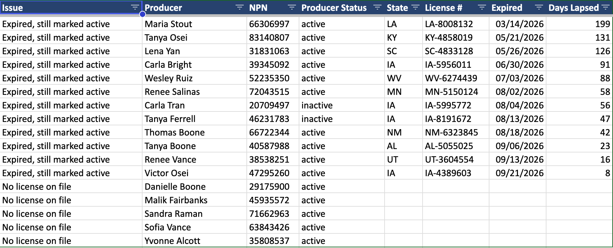

# Licensing Compliance Tracker

A producer licensing register in MariaDB, with a Python report that
flags lapsed and expiring licenses every Monday morning.



## The problem

A license can stay marked active in a register after it expires, when
a missed renewal never gets recorded. A compliance audit looks for
records like these, and this report finds them first.

## How it works

- MariaDB holds the register: producers, all 51 jurisdictions, and
  every license. A license's status and expiration date can disagree.
- `build_report.py` reads the register and writes a four-tab Excel
  workbook: Dashboard, Expiring Soon, Exceptions and Full Roster.
- The Exceptions tab lists licenses that expired but are still marked
  active, and active producers with no license on file.
- cron runs the report every Monday at 6:00 AM and logs each run.
## Stack

Debian 13, MariaDB 11.8, Python 3.13, PyMySQL, openpyxl, cron

## How to run it

Needs MariaDB, Python 3 and python3-venv.

```bash
git clone https://github.com/grant-johnston/licensing-compliance-tracker.git
cd licensing-compliance-tracker
sudo mariadb -e "CREATE DATABASE licensing"
sudo mariadb licensing < sql/00_schema.sql
sudo mariadb -e "CREATE USER 'lic_app'@'localhost' IDENTIFIED BY 'your-password'"
sudo mariadb -e "GRANT SELECT, INSERT, UPDATE, DELETE ON licensing.* TO 'lic_app'@'localhost'"
python3 -m venv .venv
source .venv/bin/activate
pip install -r requirements.txt
```

Save your connection settings as `db_config.py`. It's in `.gitignore`,
so the password stays out of git:

```python
DB = {"host": "localhost", "user": "lic_app",
      "password": "your-password", "database": "licensing"}
```

`build_report.py` saves the report in `/home/grant/Reports`. On another
machine, point `OUTPUT` near its top at a folder that exists. Then
generate the test data and build the report:

```bash
python gen_roster.py
python gen_licenses.py
python build_report.py
```

## Test data

The roster is generated test data. No real producer records are used.

The generator dates every license from the day it runs, so the
register ages in real time: left alone, licenses pass their dates and
the exceptions grow, the way they would if nobody worked them.
Running `gen_licenses.py` again resets the dates.
